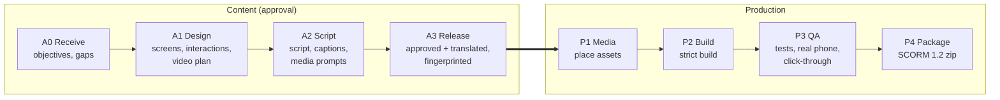

# mozapp — an AI course studio run by Claude

**mozapp** is a course-production system I designed and run inside [Claude Code](https://claude.com/claude-code).
It turns approved lesson content into **bilingual, mobile-first SCORM 1.2 e-learning**: designed, scripted, built,
tested and packaged one controlled step at a time, with a person signing off at every gate.

Claude does the heavy lifting: designing screens, writing generation prompts for video and pictures, building, checking and packaging.
The rules, the approval gates and the quality checks are what make it safe to use on real client work.

> This repository is an overview of how the system works. The source code and all client material are private.

---

## What it does

- **Takes an approved lesson and turns it into a finished module.** It splits the content into screens, chooses the
  interaction for each, and places it into a tested player.
- **Builds for phones first.** Learners are often total beginners on a phone, between shifts. Short sentences, at most
  40 words a screen, and an interaction at least every two screens.
- **Ships in two languages, including right-to-left.** Each course is built in English and a second language (for example
  Arabic, fully mirrored). The second language comes only from a human translator's approved file. Claude never writes or
  "improves" it.
- **Plans the media.** For every video and picture it writes a generation prompt, a shot list and captions, and it checks
  that every clip *teaches* something (words to hear, an action to copy or a moment to judge), not just decoration.
- **Packages SCORM 1.2 for any LMS.** Completion and scoring included, one self-contained file per course.

## How it works

One command in Claude Code, `/mozapp <step> <course>`, runs one step of a two-part pipeline. Content is approved first.
Production only ever reads the approved, fingerprinted release.

Every step has a **gate a person decides**: design approval, the client's content approval, translation sign-off and QA sign-off.
The SCORM zip cannot be made until the QA gate passes. There is no override.

## The rules that keep it honest

1. **No new facts.** Objectives, numbers, names and rules come only from the client's sources. Claude's craft is *how* it is taught:
   wording, structure, stories, visuals and interactions. Every screen carries a source tag.
2. **Objectives drive everything.** Every screen, question and asset serves a learning objective, and every objective is a job action.
3. **Teach once, retrieve often.** A concept is taught in one place and comes back as practice, never as a second lesson.
4. **One step at a time.** Each step reads only its declared input files, never chat history or memory, so results are repeatable.
5. **Nothing known ships open.** Every finding is fixed, or rejected with a one-line reason.
6. **Fresh eyes for checks.** Facts, language and video learning are reviewed by separate, isolated Claude sessions that did not write the content.

## What's inside

| Part | What it is |
|---|---|
| **Claude skill** | the `/mozapp` skill: 15 step guides and 12 craft guides (scenario writing, item writing, voice and tone, media, languages) and a numbered design rulebook |
| **Player engine** | HTML/CSS/JS player with **45+ screen types**: branching scenarios, chats, hotspots, sorting, risk boards, queue simulations, flashcards, video checks and quizzes. SCORM 1.2, RTL-ready |
| **Tools** | Python tools to build, preview, test, place media, generate producer packs, draft emails and package SCORM |
| **Checks** | content validators, plain-language word lists, schema checks, a QA gate and **40+ automated test files** |
| **Review loop** | a comment button on every preview screen, so reviewers' notes come straight back as tracked fixes |
| **Icon library** | 700+ local icons (Fluent 3D and Fluent Color, MIT) |

## Tech

Claude Code (skills, hooks, subagents) · Python · JavaScript · HTML/CSS · SCORM 1.2 · Playwright · FFmpeg · pytest

## Why I built it

Writing, building and checking dozens of bilingual modules by hand is slow and easy to get wrong. mozapp puts Claude to work
on the repetitive parts and keeps people in charge of every decision that matters: what is true, what is approved and what ships.

---

Designed and built by **Bradley Evans**, [BE Clear Communication](https://www.beclearcomm.net/success). Learning experience design and change.
